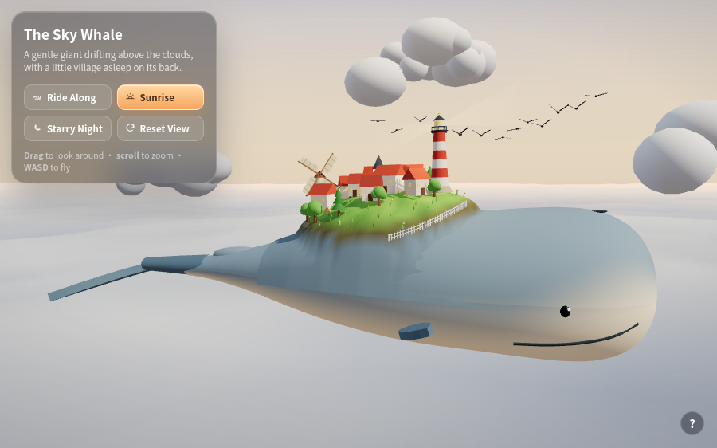
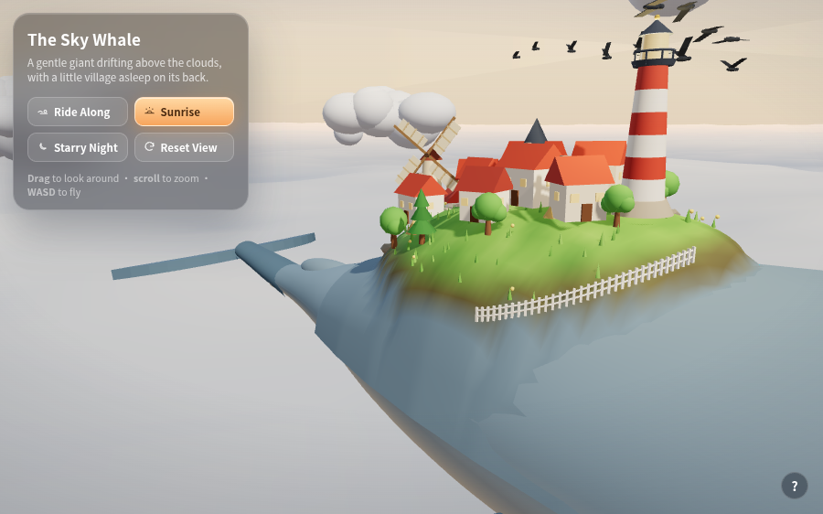
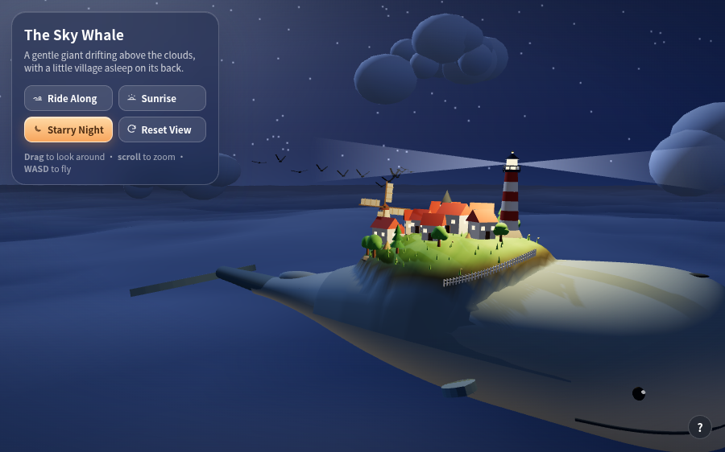

# The Sky Whale

A gentle giant drifting above the clouds, with a little village asleep on its back — a
single-page three.js scene built from the reference screenshot.

**Live demo:** <https://kamjin3086.github.io/sky-whale/>



| | |
| --- | --- |
|  |  |
| the meadow rides flush on the hull | windows, lamps and the beam come on at night |

## Run

```bash
python3 -m http.server 8137 --bind 127.0.0.1   # any static server will do
# open http://127.0.0.1:8137/index.html
```

An HTTP server is required because the scene loads ES modules (plain `file://` won't do).
three.js r168 is vendored in `vendor/`, so nothing is fetched from the network — swap the
two entries in `index.html`'s import map for the jsdelivr URLs if you would rather track a
CDN release.

## Controls

| action | input |
| --- | --- |
| fly / move | `W A S D` |
| up / down | `Q` / `E` |
| sprint | `Shift` |
| look around | drag (mouse or touch) |
| zoom | scroll wheel, pinch |
| ride along | `V` or the panel button |
| sunrise / starry night | `1` / `2` or the panel buttons |
| reset view | `R` or the panel button |
| controls list | `H` or the `?` chip |

Free flight is a 6-dof fly camera: `W A S D` moves along the view direction and strafe,
dragging orbits the look direction, scroll dollies toward what you are looking at.
**Ride Along** switches to a chase orbit that tracks the whale as it drifts; drag orbits
around it, `W/S` in-and-out, `A/D` around, `Q/E` up-and-over. Switching either way is
continuous — no jump.

## What is in the scene

* **Whale** — one lathe built from a radius/axial profile (blunt sperm-whale head, thin tail
  stock), flattened vertically, with vertex-colour countershading (cream belly, slate back,
  pale jaw) and a lifted crown for the blocky head. The tail is a separate hinged group so the
  fluke sweep never cracks the seam. Eyes, blowhole and the smile tube are placed with
  `bodySurface(x, angle)`, so they stay welded to the skin when the profile changes.
  Slow drift on a 16-unit circle, body bob, tail sweep, fin sway.
* **Meadow** — a grid draped in *hull-relative* space (`u` along the spine, `v` across the
  flanks), so the patch follows the whale's own width and its edge dissolves into the skin:
  it can never float or lip at any viewing angle. Colours blend grass → soil → hull.
* **Village** — windmill with turning sails, banded lighthouse with a sweeping twin beam and
  a real point light at night, chapel with a steeple, ten houses with warm windows that light
  up after dark, trees, picket fence, haystacks, path stones, tufts and flowers. All static
  props merge into **one** geometry (plus one merged emissive mesh for the windows), so the
  whole village is two draw calls.
* **Clouds** — a 4200-unit displaced plane with baked crest shading and a seamless soft-blob
  texture, plus 28 merged puff clusters that drift and bob; the cloud sea is repainted cheaply
  when the atmosphere changes.
* **Birds** — a 13-bird V skein that wheels above and behind the whale, wings flapping on
  per-bird phases, banking into the turn.
* **Atmosphere** — gradient sky dome with a sun/moon disc, stars, exponential fog, hemisphere
  + key + rim lights, ACES tonemapping, soft self-shadows from the whale, and a smoothly
  interpolated sunrise↔starry-night preset (all values eased every frame, so switching modes
  is a gradual dusk/dawn rather than a cut).

## Layout

```
index.html      markup, import map, boot veil
styles.css      glass control panel, keys overlay, film grade
src/core.js     renderer / scene / camera / resize
src/atmos.js    presets, sky dome, lights, stars, cloud sea, drifting puffs
src/whale.js    hull profile, countershading, tail, fins, face, swim motion
src/village.js  meadow terrain, every building and prop, windmill + lighthouse animation
src/birds.js    flock and wing flapping
src/controls.js fly camera + ride-along chase orbit
src/main.js     loop, UI wiring, window.__whale test surface
test.mjs        Playwright acceptance run
inspect.mjs     geometry dump + multi-angle diagnostic shots
```

## Test

```bash
npm i            # playwright only (browsers come from ~/.cache/ms-playwright)
node test.mjs          # everything, writes shots/*.png
node test.mjs home     # one section: home | fly | close | night | ride | reset
CHROME=/path/to/chrome node test.mjs
```

The harness boots the page in headless Chromium (SwiftShader for WebGL), asserts a clean
console, live frame rate, draw calls and triangles, then drives the real UI: drag to look,
`WASD` to fly, scroll to zoom, both presets (stars/moonlight/fog actually change), the
windmill sails, the lighthouse beam, wing flapping, ride-along tracking of the drifting
whale, and that **Reset View** lands back on the opening framing within half a unit.
`window.__whale` exposes `telemetry()`, `setMode()`, `setRide()`, `reset()` and
`rig.teleport()` for that. Typical result on software rendering: ~20 fps, 30 draw calls.
`inspect.mjs` prints world-space bounding boxes and shoots the whale from four angles when a
shape needs chasing down.

## Notes and gotchas

* `LatheGeometry` derives its normals from the direction of travel of the profile: a profile
  listed top→bottom produces **inward** normals and the surface is lit from the wrong side
  (that bug is what made the whale look like a flat cut-out). Every profile here is fed
  bottom→top.
* `ExtrudeGeometry`/`BoxGeometry` shapes get pre-baked transforms *after* `prep()`, because
  `prep()` returns a new geometry when it has to un-index one.
* The cloud sea does not receive shadows — at this sun elevation the whale's shadow lands far
  away from it and only muddies the deck; props still shadow the meadow.
* Shadows use one tight ortho frustum that follows the whale (`lightTheWhale`), which keeps
  texel density high enough for the village.
